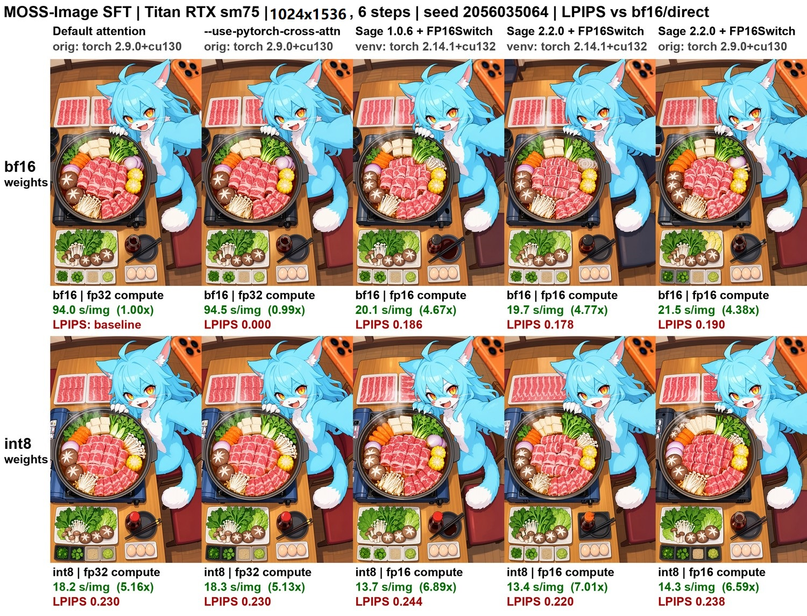

# ComfyUI_MiraSubPack
More test nodes for my [ComfyUI_Mira](https://github.com/mirabarukaso/ComfyUI_Mira)

## Model (Mira/SubPack/Model)
- **Sage FP16 Switch (Mira SubPack)** `SageFP16Switch_MiraSubPack`: place after the model loader. Sets this model's compute dtype to fp16 and (optional) casts attention q/k/v to fp16 for SageAttention. Per-model, no global patch; bypass to disable. Useful on GPUs without bf16 (e.g. Turing).
- **Load Diffusion Model FP16 Storage (Mira SubPack)** `UNETLoaderFP16Storage_MiraSubPack`: UNETLoader variant storing weights as fp16 (half VRAM of fp32).

### SageFP16Switch benchmark: MOSS-Image SFT, bf16 vs int8 (Titan RTX, sm75)
- GPU: Titan RTX (Turing sm75, no hardware bf16). Orig env: Python 3.13, torch 2.9.0+cu130, sageattention 2.2.0. Test venvs: torch 2.14.1+cu132, triton-windows 3.2, with sageattention 1.0.6 or 2.2.0 (otherwise identical `pip freeze`).
- Workflow: MOSS-Image SFT + sft 4-step LoRA v2.0 + style LoRA, SkipLayerGuidance (single layer 22), Qwen3.5-9B int8 text encoder, flux2 VAE, 1024x1536, 6 steps, euler/simple, cfg 2.0.
- Seeds: 777 warm-up (discarded), timed on 2056035064 and 2056035065. s/image = mean server execution time of the 2 timed runs (model load excluded).
- LPIPS (AlexNet), mean of both seeds, vs **bf16 / default attention / orig env**. Sage rows use `SageFP16Switch_MiraSubPack` (compute_fp16 + sage_cast).

| Weights | Env / torch | Attention | Compute dtype | s/image | Speedup | LPIPS |
|---|---|---|---|---|---|---|
| bf16 | orig / 2.9.0 | default | fp32 (bf16 upcast) | 94.0 | 1.00x | baseline |
| bf16 | orig / 2.9.0 | `--use-pytorch-cross-attention` | fp32 | 94.5 | 0.99x | 0.0000 |
| bf16 | venv / 2.14.1 | sage 1.0.6 + switch | fp16 | 20.1 | 4.67x | 0.1856 |
| bf16 | venv / 2.14.1 | sage 2.2.0 + switch | fp16 | 19.7 | 4.77x | 0.1784 |
| bf16 | orig / 2.9.0 | sage 2.2.0 + switch | fp16 | 21.5 | 4.38x | 0.1902 |
| int8 | orig / 2.9.0 | default | fp32 (manual cast) | 18.2 | 5.16x | 0.2304 |
| int8 | orig / 2.9.0 | `--use-pytorch-cross-attention` | fp32 (manual cast) | 18.3 | 5.13x | 0.2304 |
| int8 | venv / 2.14.1 | sage 1.0.6 + switch | fp16 | 13.7 | 6.89x | 0.2440 |
| int8 | venv / 2.14.1 | sage 2.2.0 + switch | fp16 | 13.4 | 7.01x | 0.2197 |
| int8 | orig / 2.9.0 | sage 2.2.0 + switch | fp16 | 14.3 | 6.59x | 0.2378 |

Attention-only microbench (B1, H24, D128, fp16, 5x100 iters, mean ms of the first round; the second round was ~5% slower across all configs):

| Env / torch | sage | L=4608 | L=14336 | SDPA L=14336 |
|---|---|---|---|---|
| venv / 2.14.1 | 1.0.6 | 3.57 | 32.81 | 70.7 |
| venv / 2.14.1 | 2.2.0 | 3.47 | 31.24 | 72.3 |
| orig / 2.9.0 | 2.2.0 | 3.71 | 33.21 | 73.7 |

Notes:
- Default attention already resolves to PyTorch SDPA on this build, so "default" and `--use-pytorch-cross-attention` are the same path (identical images).
- sage 1.0.6 vs 2.2.0 speed gap comes from the env (torch 2.9.0 vs 2.14.1), not the sage version: in the same venv, sage 2.2.0 is ~3-5% faster attention-only and ~2% faster end-to-end than 1.0.6. Most of the orig-env deficit is probably outside attention (not isolated).
- sage 1.0.6 and 2.2.0 do not produce identical images on sm75 (LPIPS ~0.18-0.21 between the two versions), so their Triton kernels are not numerically the same.
- The sage 2.2.0 venv uses the Python/Triton sources of a local 2.2.0 build with the CUDA extension stubbed out (only the Triton path is used on sm75).
- int8 is much faster than bf16 here likely because the int8 weights avoid the full fp32 matmul path, but this was not profiled.
- No sage failures or fallbacks; the switch confirmed fp16 q/k/v in all sage runs.

